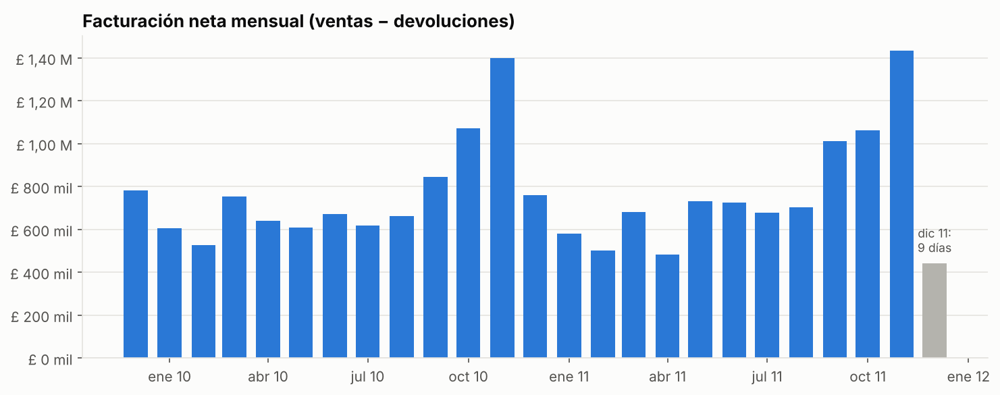
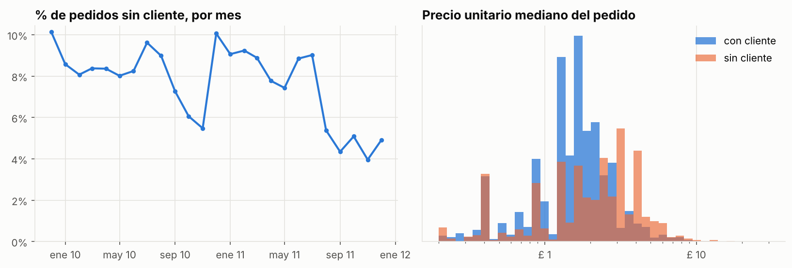
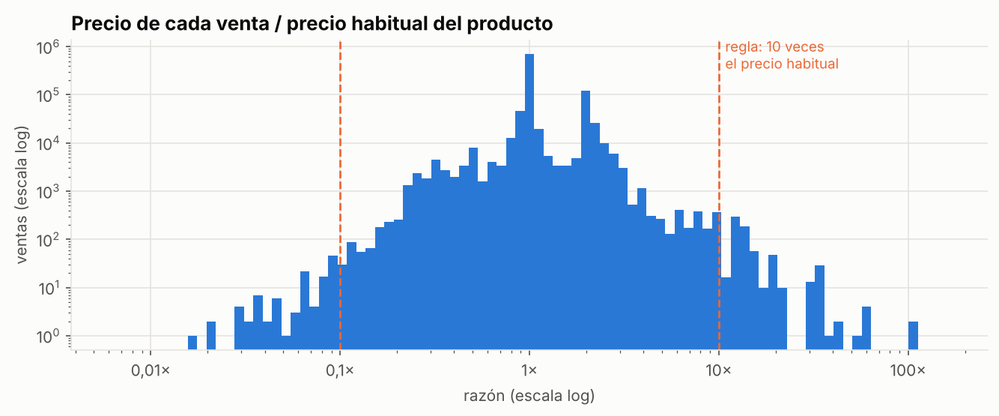
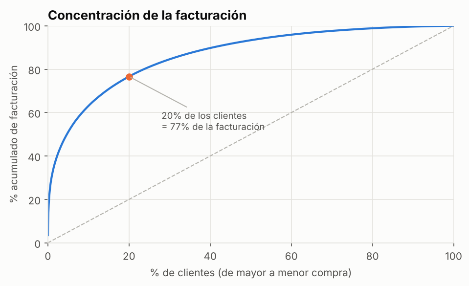
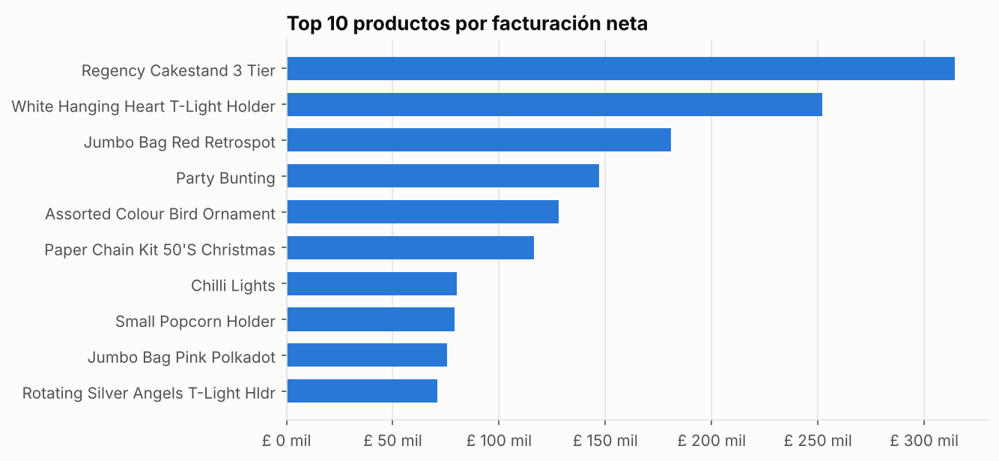
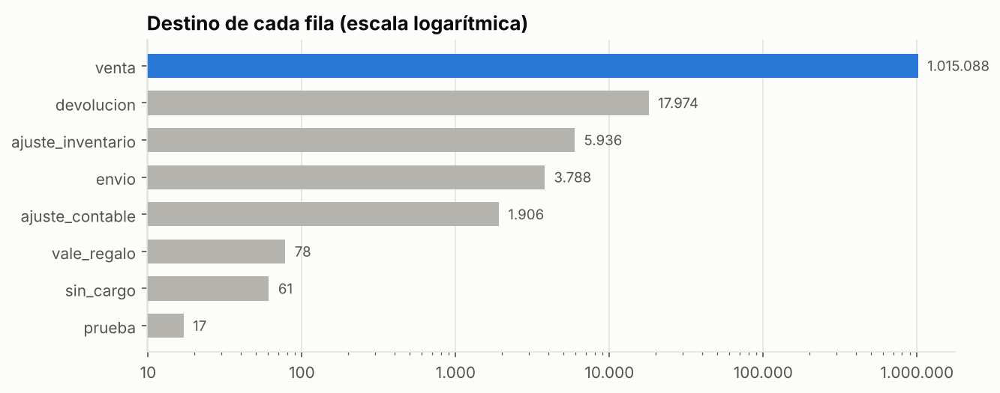

# Limpieza y análisis de 1 millón de transacciones reales de un e-commerce

🇬🇧 [English version](README.md) · 🇪🇸 Español

Proyecto de portfolio con **datos reales y sucios**, donde las anomalías no se conocían de antemano y hubo que descubrirlas con análisis.

**Datos:** *Online Retail II* (UCI Machine Learning Repository). 1.067.371 líneas de factura de un e-commerce mayorista de regalos del Reino Unido, de diciembre de 2009 a diciembre de 2011.



## El problema de negocio

El dueño quiere saber **cuánto vende de verdad, quiénes son sus clientes, qué se devuelve y cómo planificar el año**. Pero la exportación de su sistema mezcla en una sola tabla ventas, devoluciones, pedidos anulados, cargos de envío, comisiones, ajustes de inventario y errores de carga. Sumar esa tabla tal cual da una facturación incorrecta, una tasa de devolución que duplica la real y rankings de productos que no existen.

## Lo que se descubrió

| Hallazgo | Magnitud | Consecuencia si no se detecta |
|---|---|---|
| Las dos hojas del Excel repiten el 1–9 de diciembre de 2010 | 22.523 filas | Ventas de ese período contadas dos veces |
| Ajustes de inventario ("damaged", "lost", "found") cargados como movimientos de producto | 5.936 filas | Unidades que en realidad son mermas |
| Pedidos anulados dentro de las 24 h (uno de **80.995 unidades**, anulado a los 12 minutos) | £ 351 mil | Tasa de devolución de 3,7% en vez de la real, 1,9% |
| Un lote **refacturado a otro cliente** 49 días después | 45 líneas, 87.167 unidades | Productos con un 49% de "devolución" falsa |
| Clientes faltantes **no aleatorios** | 22% de las líneas, 13% de la facturación | Descartarlos sesga todo hacia el canal mayorista |
| Precios a más de 10 veces del habitual (un banderín de £ 0,42 cobrado a £ 1.157) | 881 ventas | Precios promedio y márgenes distorsionados |
| Cargos de envío, comisiones de Amazon, deudas incobrables, vales de regalo, productos de prueba | 21 códigos que no son productos | Ingresos y gastos que no son ventas de productos |

## Rigor estadístico

### ¿Por qué falta el cliente? (MCAR vs. MAR vs. MNAR)

- El faltante es **por pedido completo, nunca por línea**: no es un error de tipeo al azar.
- Los pedidos sin cliente pagan un precio unitario **1,7 veces más alto**, tienen más líneas y menor importe total: es el perfil de un comprador minorista sin cuenta.
- **Prueba formal:** una regresión logística predice qué pedidos no tienen cliente usando solo variables observadas, con un **AUC de 0,875** con validación cruzada. Si fuera MCAR, el AUC sería 0,5. Por lo tanto **no es MCAR**, y el patrón es compatible con MAR (depende del canal de compra).
- Con casi 40.000 pedidos, cualquier diferencia da p < 0,05. Por eso las conclusiones se apoyan en **tamaños de efecto** (razón de medianas, V de Cramér, AUC), no en p-valores.
- **Decisión:** no imputar IDs, porque inventaría clientes. Las ventas sin cliente se **conservan** en facturación y demanda, y se excluyen **solo** del análisis por cliente, aclarando el sesgo que eso implica.



### Precios atípicos: por qué el método de manual falla acá

El z-score robusto (Iglewicz y Hoaglin) marcaría **26.643 ventas**, la mayoría con precio minorista normal. En este negocio conviven dos precios por producto (mayorista y minorista, cerca del doble), y en el 84% de las ventas el precio del producto es casi constante (MAD = 0), donde el z-score ni siquiera se puede calcular. Se usó una regla acorde a esa estructura: marcar solo precios a **más de 10 veces** del habitual del producto. Las 881 ventas marcadas **se marcan, no se borran**, y el impacto se mide.



### Decisiones con análisis de sensibilidad

| Situación | Decisión | Impacto medido |
|---|---|---|
| Líneas idénticas en una misma factura (11.733) | Se conservan y se marcan | Eliminarlas bajaría la facturación 0,29% |
| Precios atípicos (881) | Fuera del análisis de precios; dentro de la facturación | 0,39% de la facturación |
| Ventas sin cliente | Se conservan, salvo en el análisis por cliente | 13% de la facturación |
| Devoluciones vs. anulaciones | Se separan con una regla explícita (cantidad completa en 24 h) | La tasa de devolución pasa de 3,7% a 1,9% de las ventas brutas |

## Resultados para el negocio

1. **Negocio estable y muy estacional:** creció +1,8% interanual (£ 9,19 M → £ 9,35 M), y de septiembre a noviembre concentra el 36–38% del año.
2. **Alta dependencia de pocos clientes:** el 1% de los clientes registrados genera el 31% de la facturación y el 20% genera el 77%.
3. **Retención mejorable:** el 64% de los clientes del primer año volvió a comprar en el segundo.
4. **Las devoluciones se concentran en productos frágiles** (vidrio y cerámica) **y en luces:** revisar embalaje y proveedores de esas líneas ataca la causa probable.
5. **Catálogo de cola larga:** los 10 productos principales suman solo el 7% de la facturación, sobre 4.725 productos.

<p>
  
  
</p>

### Qué habilitan los datos limpios

- **Pronóstico de demanda** con estacionalidad anual, para comprar antes del pico de septiembre a noviembre. Con los datos crudos, el modelo aprendería de pedidos anulados y del período duplicado.
- **Segmentación de clientes (RFM) y valor de vida (CLV)**, con devoluciones bien atribuidas.
- **Alertas automáticas:** las reglas del pipeline se pueden correr cada día sobre los datos nuevos.

## La solución técnica

`src/limpiar_retail.py` no borra lo que "parece raro": **clasifica cada fila** en uno de 9 tipos de movimiento y verifica que no se pierda ninguna.



| Salida | Contenido |
|---|---|
| `ventas.csv.gz` | 1.015.088 líneas de venta, con marcas `precio_atipico` y `linea_repetida` |
| `devoluciones.csv.gz` | 17.974 devoluciones, emparejadas con su compra original y con la marca `anulacion_24h` |
| `otros_movimientos.csv.gz` | Envíos, ajustes contables y de inventario, vales, entregas sin cargo y pruebas |
| `log_limpieza.csv` | Cada paso, con cuántas filas afectó y por qué |

**Tests:** 32 pruebas sobre cada regla de clasificación y sobre casos límite: texto en columnas numéricas, precios negativos, cantidades 0, distribuciones muy sesgadas, distribuciones bimodales de precios y superposición de hojas.

## Cómo usarlo

Requiere Python 3.12 o superior (probado con 3.14). El piso lo fijan las versiones exactas de `requirements.txt` (NumPy 2.5 y SciPy 1.18 exigen 3.12).

```bash
git clone https://github.com/SpixeBR/proyecto-4-retail-datos-reales.git
cd proyecto-4-retail-datos-reales
python -m venv .venv
# Windows: .venv\Scripts\activate   ·   macOS/Linux: source .venv/bin/activate
pip install -r requirements.txt
```

1. Descargá `online_retail_II.xlsx` desde el [UCI Machine Learning Repository](https://archive.ics.uci.edu/dataset/502/online+retail+ii) y guardalo en `data/raw/`. Por su tamaño (45 MB) no se incluye en el repositorio.
2. Ejecutá:

| Para… | Comando |
|---|---|
| Limpiar los datos | `python src/limpiar_retail.py data/raw/online_retail_II.xlsx data/processed` |
| Correr los tests | `pytest -q` |
| Ver el análisis | `jupyter notebook notebooks/analisis_retail.ipynb` |

Los resultados limpios (`data/processed/`) ya están incluidos, así que el notebook se puede leer en GitHub sin correr nada.

## Estructura

```
├── data/
│   ├── raw/                       # acá va online_retail_II.xlsx (no incluido)
│   └── processed/                 # ventas, devoluciones, otros movimientos y log
├── figures/                       # gráficos del análisis
├── notebooks/analisis_retail.ipynb
├── src/limpiar_retail.py          # pipeline de limpieza (CLI + funciones)
├── tests/test_limpiar_retail.py
├── LICENSE                        # MIT (código)
└── requirements.txt
```

## Licencias y fuente de los datos

- **Código:** licencia [MIT](LICENSE) © 2026 Bruno.
- **Datos:** Chen, D. (2012). *Online Retail II* [Dataset]. UCI Machine Learning Repository. https://doi.org/10.24432/C5CG6D. Licencia [CC BY 4.0](https://creativecommons.org/licenses/by/4.0/) de UCI. Los archivos de `data/processed/` derivan de ese dataset (limpiados y clasificados) y conservan esa licencia y su atribución. La licencia MIT cubre solo el código, no los datos.

**Herramientas:** Python, pandas, NumPy, SciPy, scikit-learn, matplotlib, pytest, Jupyter.
