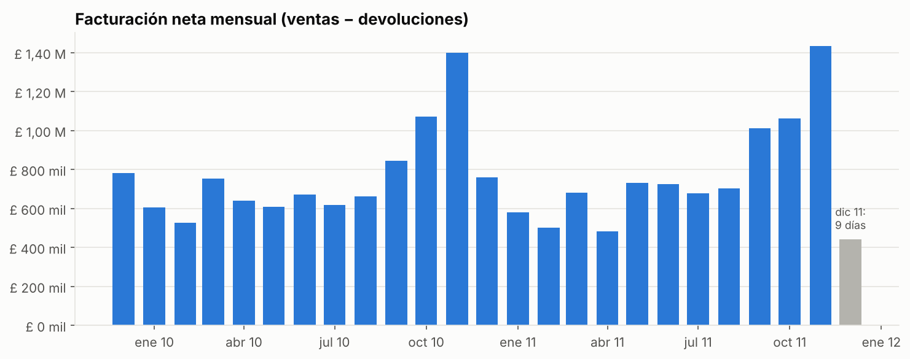
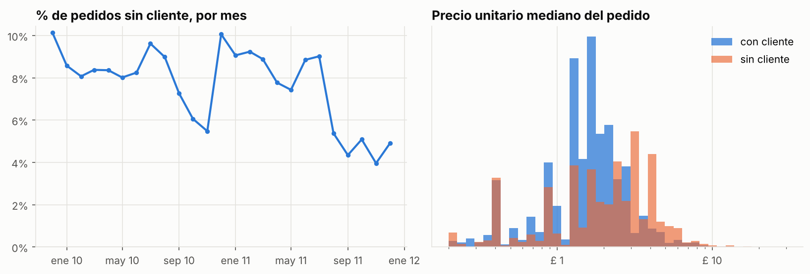
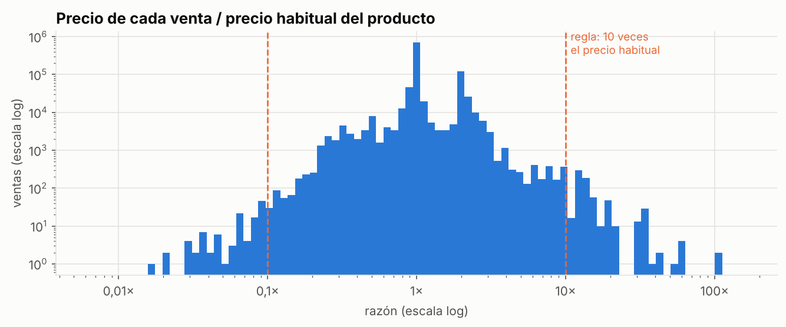
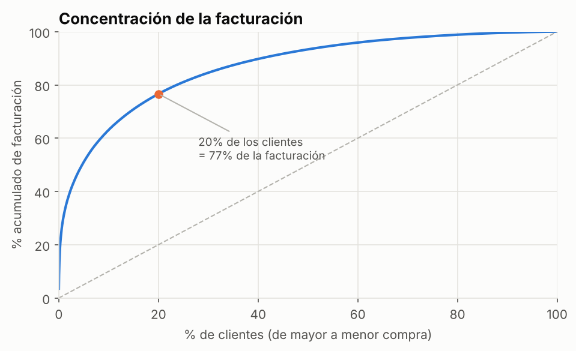
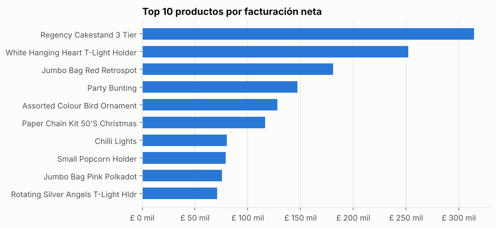
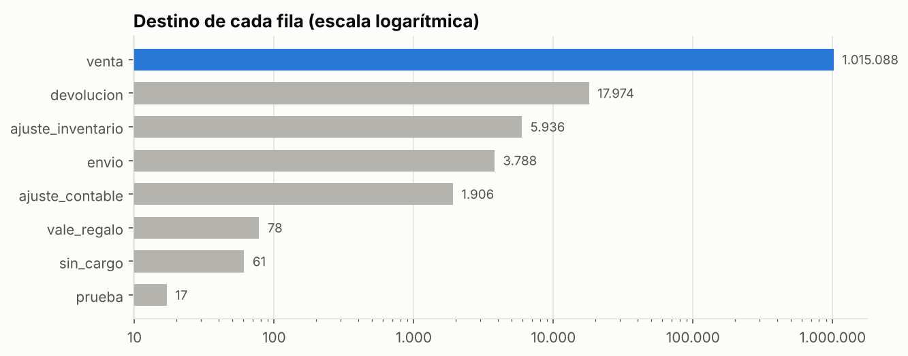

# Cleaning and analysing 1 million real e-commerce transactions

🇬🇧 English · 🇪🇸 [Versión en español](README.es.md)

A portfolio project on **real, messy data** where the anomalies were not known in advance and had to be discovered through analysis.

**Data:** *Online Retail II* (UCI Machine Learning Repository). 1,067,371 invoice lines from a UK-based wholesale gift e-commerce business, December 2009 to December 2011.

> **Language note:** the code, notebook, column names and figures are in Spanish. This README and `README.es.md` carry the same content.



## The business problem

The owner wants to know **how much the business really sells, who its customers are, what gets returned, and how to plan the year**. But the system export mixes sales, returns, cancelled orders, shipping charges, fees, inventory adjustments and data-entry errors in one table. Summing it as-is gives wrong revenue, a return rate about double the real one, and product rankings that don't exist.

## What was found

| Finding | Size | Consequence if undetected |
|---|---|---|
| The two Excel sheets overlap on 1–9 December 2010 | 22,523 rows | Sales in that period counted twice |
| Inventory adjustments ("damaged", "lost", "found") loaded as product movements | 5,936 rows | "Units sold" that are really losses |
| Orders cancelled within 24 h (one of **80,995 units**, cancelled after 12 minutes) | £351k | Return rate of 3.7% instead of the real 1.9% |
| A batch **re-invoiced to another customer** 49 days later | 45 lines, 87,167 units | Products showing a false 49% "return" rate |
| Missing customers that are **not random** | 22% of lines, 13% of revenue | Dropping them biases everything toward the wholesale channel |
| Prices more than 10× the usual (a £0.42 car flag charged at £1,157) | 881 sales | Distorted average prices and margins |
| Shipping charges, Amazon fees, bad debt, gift vouchers, test products | 21 codes that are not products | Income and expenses that are not product sales |

## Statistical rigour

### Why is the customer missing? (MCAR vs. MAR vs. MNAR)

- Missingness occurs **per whole order, never per line**: it is not a random typing error.
- Orders without a customer pay a **1.7× higher** unit price, have more lines and a lower total: the profile of a retail buyer without an account.
- **Formal test:** a logistic regression predicts which orders lack a customer from observed variables only, reaching a cross-validated **AUC of 0.875**. Under MCAR the AUC would be 0.5. So it is **not MCAR**, and the pattern is consistent with MAR (it depends on the purchase channel).
- With almost 40,000 orders, any difference gives p < 0.05. Conclusions therefore rest on **effect sizes** (median ratio, Cramér's V, AUC), not p-values.
- **Decision:** do not impute IDs, since that would invent customers. Sales without a customer are **kept** in revenue and demand, and excluded **only** from customer-level analysis, stating the resulting bias.



### Price outliers: why the textbook method fails here

The robust z-score (Iglewicz and Hoaglin) would flag **26,643 sales**, most at a normal retail price. This business has two prices per product (wholesale and retail, about 2× apart), and for 84% of sales the product price is nearly constant (MAD = 0), where the z-score cannot even be computed. A rule matched to that structure was used instead: flag only prices **more than 10×** the product's usual price. The 881 flagged sales are **flagged, not deleted**, and the impact is measured.



### Decisions backed by sensitivity analysis

| Situation | Decision | Measured impact |
|---|---|---|
| Identical lines within one invoice (11,733) | Kept and flagged | Removing them would lower revenue by 0.29% |
| Price outliers (881) | Excluded from price analysis; kept in revenue | 0.39% of revenue |
| Sales without a customer | Kept, except in customer-level analysis | 13% of revenue |
| Returns vs. cancellations | Separated by an explicit rule (full quantity within 24 h) | Return rate drops from 3.7% to 1.9% of gross sales |

## Business results

1. **Stable, highly seasonal business:** net revenue grew +1.8% year over year (£9.19M → £9.35M, December–November years), and September to November concentrates 36–38% of the year.
2. **High dependence on few customers:** the top 1% of registered customers generate 31% of revenue and the top 20% generate 77%.
3. **Retention can improve:** 64% of first-year customers bought again in the second year.
4. **Returns concentrate in fragile products** (glass and ceramics) **and lights:** reviewing packaging and suppliers for those lines targets the likely cause.
5. **Long-tail catalogue:** the top 10 products make up only 7% of revenue, out of 4,725 products.

<p>
  
  
</p>

### What the clean data enables

- **Demand forecasting** with annual seasonality, to buy ahead of the September–November peak. On raw data, a model would learn from cancelled orders and the duplicated period.
- **Customer segmentation (RFM) and lifetime value (CLV)**, with returns correctly attributed.
- **Automatic alerts:** the pipeline rules can run daily on new data.

## The technical solution

`src/limpiar_retail.py` does not delete what "looks odd": it **classifies every row** into one of 9 movement types and checks that none is lost.



| Output | Content |
|---|---|
| `ventas.csv.gz` | 1,015,088 sales lines, with `precio_atipico` and `linea_repetida` flags |
| `devoluciones.csv.gz` | 17,974 returns, matched to their original purchase and flagged `anulacion_24h` |
| `otros_movimientos.csv.gz` | Shipping, accounting and inventory adjustments, vouchers, free deliveries and tests |
| `log_limpieza.csv` | Every step, with how many rows it affected and why |

**Tests:** 32 tests covering each classification rule and edge cases: text in numeric columns, negative prices, zero quantities, heavily skewed distributions, bimodal price distributions and sheet overlap.

## Usage

Requires Python 3.12 or newer (tested on 3.14). The floor comes from the exact versions pinned in `requirements.txt` (NumPy 2.5 and SciPy 1.18 require 3.12).

```bash
git clone https://github.com/SpixeBR/proyecto-4-retail-datos-reales.git
cd proyecto-4-retail-datos-reales
python -m venv .venv
# Windows: .venv\Scripts\activate   ·   macOS/Linux: source .venv/bin/activate
pip install -r requirements.txt
```

1. Download `online_retail_II.xlsx` from the [UCI Machine Learning Repository](https://archive.ics.uci.edu/dataset/502/online+retail+ii) and save it in `data/raw/`. It is not included in the repository because of its size (45 MB).
2. Run:

| To… | Command |
|---|---|
| Clean the data | `python src/limpiar_retail.py data/raw/online_retail_II.xlsx data/processed` |
| Run the tests | `pytest -q` |
| View the analysis | `jupyter notebook notebooks/analisis_retail.ipynb` |

The clean outputs (`data/processed/`) are already included, so the notebook can be read on GitHub without running anything.

## Structure

```
├── data/
│   ├── raw/                       # put online_retail_II.xlsx here (not included)
│   └── processed/                 # sales, returns, other movements and log
├── figures/                       # analysis charts
├── notebooks/analisis_retail.ipynb
├── src/limpiar_retail.py          # cleaning pipeline (CLI + functions)
├── tests/test_limpiar_retail.py
├── LICENSE                        # MIT (code)
└── requirements.txt
```

## Licenses and data source

- **Code:** [MIT](LICENSE) © 2026 Bruno.
- **Data:** Chen, D. (2012). *Online Retail II* [Dataset]. UCI Machine Learning Repository. https://doi.org/10.24432/C5CG6D. Licensed by UCI under [CC BY 4.0](https://creativecommons.org/licenses/by/4.0/). The files in `data/processed/` are derived from that dataset (cleaned and classified) and keep that license and attribution. The MIT license applies to the code only, not to the data.

**Tools:** Python, pandas, NumPy, SciPy, scikit-learn, matplotlib, pytest, Jupyter.
